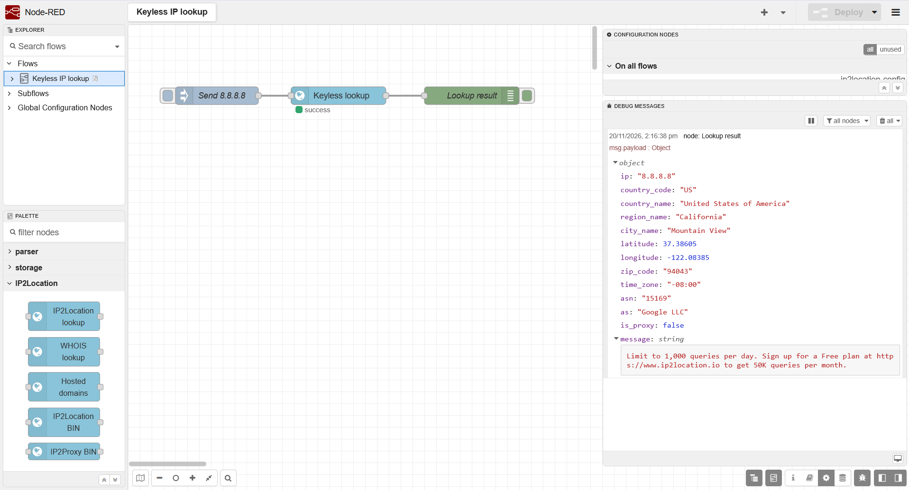
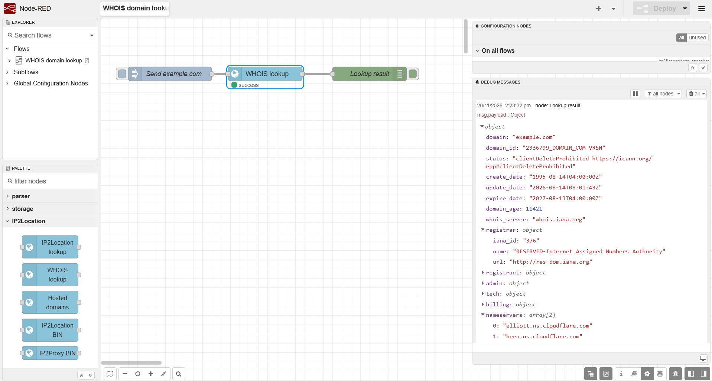
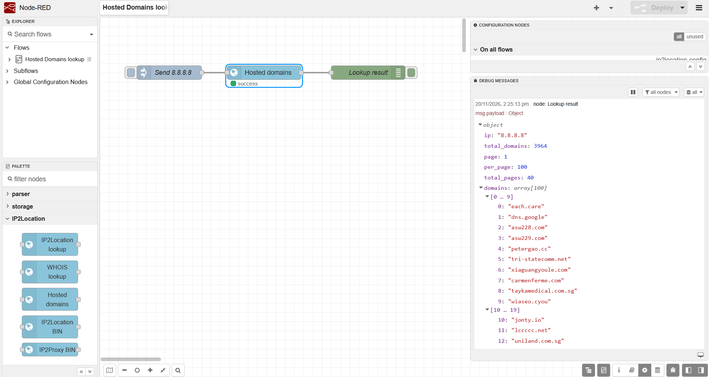
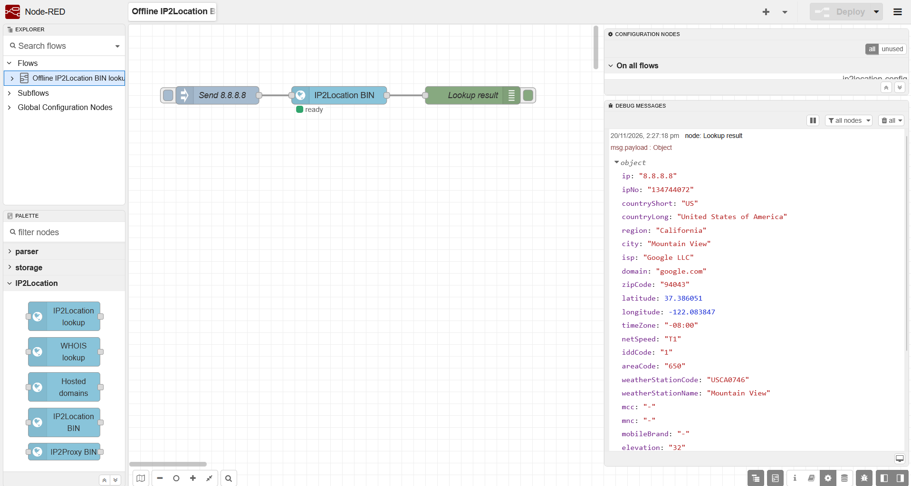
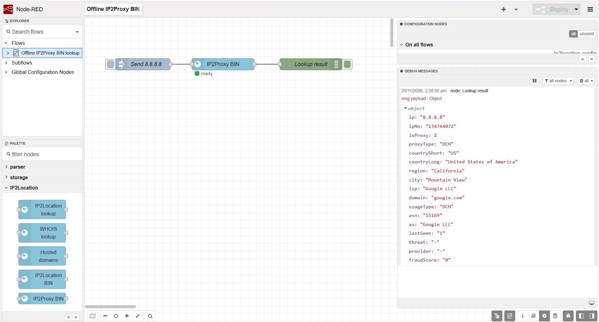

# node-red-contrib-ip2location

[](https://nodered.org/)

Node-RED nodes for online IP geolocation, WHOIS and hosted-domain lookups, plus offline IP2Location and IP2Proxy BIN database lookups. Online lookups use the official `ip2location-io-nodejs` SDK; offline lookups use `ip2location-nodejs` and `ip2proxy-nodejs`.

## Nodes

| Node | Function |
| --- | --- |
| `ip2location-config` | Stores an API key as a Node-RED credential (optional for keyless IP geolocation). |
| `ip2location-lookup` | Online IP geolocation, ASN, ISP and plan-dependent proxy information. |
| `ip2location-whois` | WHOIS information for a domain. |
| `ip2location-hosted-domains` | Domains hosted on an IP address (one page per message). |
| `ip2location-offline` | Offline geolocation using an IP2Location BIN database. |
| `ip2proxy-offline` | Offline proxy detection using an IP2Proxy BIN database. |

The five processing nodes appear in the **IP2Location** palette category. `ip2location-config` is a configuration node, not a standalone processing node.

## Requirements

- Node-RED **3.0 or later** and a compatible Node.js version. This package declares **Node.js 18 or later**; the Node-RED version you run may require a newer Node.js release. A supported LTS version is recommended.
- Internet connectivity for the online nodes.
- An API key for WHOIS and Hosted Domains. IP geolocation also supports a keyless mode limited to **1,000 requests per day**.
- An appropriate IP2Location or IP2Proxy **LITE or commercial BIN** file for offline lookups. BIN files are **not included**.

**Attribution:** Keyless and Free-plan usage requires attribution under the applicable IP2Location.io terms. Review the [IP2Location.io website](https://www.ip2location.io/) for the current requirements before using data in a public-facing application.

## Installation

After the package is published to npm, install it from your Node-RED user directory:

```bash
cd ~/.node-red
npm install node-red-contrib-ip2location
```

For local development or testing **before publication**, install it from a checked-out project directory instead:

```bash
cd ~/.node-red
npm install /absolute/path/to/node-red-contrib-ip2location
```

On Windows (PowerShell):

```powershell
cd $HOME\.node-red
npm install "C:\path\to\node-red-contrib-ip2location"
```

Restart Node-RED after installation and refresh the editor. For development and automated tests, see the source repository.

## Configuration and usage

### Online nodes

1. Add an online lookup node to a flow. Select **Credentials** and create an `IP2Location.io credentials` configuration.
2. Leave the API key blank for **keyless IP geolocation**; provide a valid key for authenticated IP geolocation, WHOIS or Hosted Domains.
3. Connect an **Inject** node to provide the input and a **Debug** node to inspect `msg.payload`.
4. Click **Deploy**, then trigger the Inject node. Connect a **Catch** node to handle failures.

**Message inputs and outputs:**

| Node | Input | Options | Output |
| --- | --- | --- | --- |
| `ip2location-lookup` | `msg.ip`, otherwise `msg.payload` (IP string) | `msg.lang` overrides the configured language; blank language is omitted | Geolocation API response in `msg.payload` |
| `ip2location-whois` | `msg.domain`, otherwise `msg.payload` (domain string) | — | WHOIS API response in `msg.payload` |
| `ip2location-hosted-domains` | `msg.ip`, otherwise `msg.payload` (IP string) | `msg.page` overrides configured **Page** (default `1`); must be a positive integer | One page of Hosted Domains results in `msg.payload` |

When `msg.ip` or `msg.domain` is present but invalid, the node raises an error instead of falling back to `msg.payload`. Other message properties are preserved on success.

For example, an Inject node can send the string `8.8.8.8` as `msg.payload`, or a Function node can set:

```javascript
msg.ip = '8.8.8.8';
return msg;
```

WHOIS example:

```javascript
msg.domain = 'example.com';
return msg;
```

Internationalized domains are converted to ASCII (Punycode) before lookup, and a trailing dot is accepted. Supply a domain name, not a complete URL.

**Response fields:** IP geolocation may include `country_code`, `country_name`, `region_name`, `city_name`, `latitude`, `longitude`, `asn`, `isp` and `is_proxy`. WHOIS may return registrar, registration dates and nameservers. Available fields depend on the service response and subscription plan; language-specific results may require an eligible plan.

**Timeouts:** Each online processing node has a **Timeout (ms)** setting, defaulting to **10,000 ms (10 seconds)**. The node reports a timeout through a Catch node when the limit is reached. The timeout stops waiting for the SDK result; it does **not** abort the SDK's underlying HTTP request.

**Hosted Domains pagination:** Each incoming message retrieves **one page only**. Set **Page** in the editor or send `msg.page = 2` to request page 2; the node does not automatically collect subsequent pages.

### Offline BIN nodes

1. Add `ip2location-offline` or `ip2proxy-offline`.
2. Set **BIN file** to an absolute path on the machine/container running Node-RED, and select a database matching the node type.
3. Send an IP address using `msg.ip` or `msg.payload`.

The BIN opens when the node starts; successful initialization shows a green **ready** status. The same database stays open for subsequent lookups. After replacing the BIN file, send **`msg.reload = true`** with an IP lookup to reopen it, or redeploy the flow. File changes are **not** detected automatically.

Offline lookups do not require a network connection or API key. The output is the SDK's result object in `msg.payload`, with fields determined by the BIN edition. Offline field names differ from online API names: for example, the BIN SDKs use `countryShort` whereas the online API uses `country_code`. Do not assume online and offline result objects are interchangeable.

## Example flows

Import the sample flows from [`examples/`](examples/) using **Menu → Import** in Node-RED. The six examples use unique node IDs, so multiple example flows can be imported into the same workspace without ID conflicts.

- **Keyless IP lookup:** Includes an IP2Location.io configuration node without an API key; deploy and trigger the Inject node.
- **Authenticated IP lookup, WHOIS, and Hosted Domains:** Include configuration nodes. **Enter your own API key** in the configuration before deploying. Hosted Domains requests page 1 by default; `msg.page` can override it.
- **Offline IP2Location and IP2Proxy:** Replace the placeholder **BIN file** path in the node editor with an absolute path to your own matching BIN database before deploying.

Each example sends a sample string through **Inject → lookup → Debug**. Open the Debug sidebar to inspect `msg.payload`. No API credentials or BIN databases are distributed with the examples.

## Troubleshooting

| Problem | What to check |
| --- | --- |
| Invalid IP input | Send a valid IPv4 or IPv6 string in `msg.ip` or `msg.payload`, not an object. An invalid present `msg.ip` does not fall back to `msg.payload`. |
| Keyless daily quota exceeded | Keyless IP geolocation has a **1,000 requests/day** limit. On exhaustion, the API returns error **10000** (HTTP 429); configure a free API key to get **50,000 queries/month** under the advertised free allowance. |
| WHOIS / Hosted Domains fails without a key | These nodes require a configured API key. |
| Insufficient credits | API error **10004** for WHOIS / Hosted Domains indicates insufficient credits; review the account balance or plan. |
| Translated lookup fails | Clear `lang` / `msg.lang`, or verify that the plan supports the selected language. |
| API request times out | Increase **Timeout (ms)** if appropriate, and use a Catch node to handle the error. |
| Missing or unreadable BIN | Verify the path, permissions, file integrity and database type. BIN lookup errors are reported through Catch nodes. |
| IPv6 with an IPv4-only BIN | Use an IPv6-capable BIN. IP2Location can return **`IPV6_NOT_SUPPORTED`**; IP2Proxy can return **`IPV6 ADDRESS MISSING IN IPV4 BIN`**. Both are treated as errors. |
| BIN file has been updated but results are old | Send `msg.reload = true` with an IP lookup, or redeploy the node to reopen the BIN file. |

Node errors can be handled using a Node-RED **Catch** node. Errors do not produce normal successful lookup results.

## Screenshots

### Online API nodes








### Offline BIN nodes





## Related SDKs

- [IP2Location.io Node.js SDK](https://github.com/ip2location/ip2location-io-nodejs)
- [IP2Location Node.js BIN SDK](https://github.com/ip2location/ip2location-nodejs)
- [IP2Proxy Node.js BIN SDK](https://github.com/ip2location/ip2proxy-nodejs)

## License

MIT — see [LICENSE](LICENSE).
