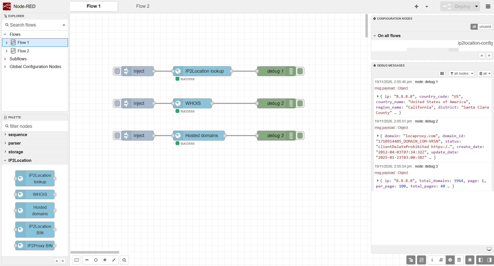
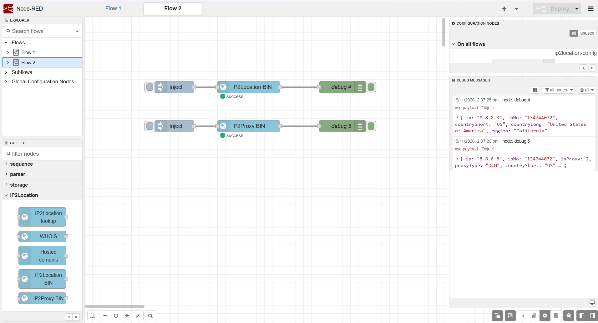

# node-red-contrib-ip2location

[](https://nodered.org/)

Six Node-RED nodes for IP2Location.io geolocation, IP2WHOIS, hosted domains, and offline IP2Location/IP2Proxy BIN lookups.

## Included nodes

| Node | What it does |
|---|---|
| `ip2location-config` | API key stored as a Node-RED credential (optional for basic IP lookup) |
| `ip2location-lookup` | Online IP geolocation, ASN and available proxy data |
| `ip2location-whois` | WHOIS domain lookup |
| `ip2location-hosted-domains` | Domain names hosted on an IP |
| `ip2location-offline` | Local IP2Location BIN lookup |
| `ip2proxy-offline` | Local IP2Proxy BIN proxy classification |

## Requirements

- Node-RED 3.0+ with Node.js 18+ (use a maintained LTS version for deployment).
- Internet access for online nodes, or an appropriate local BIN file for offline nodes.
- An IP2Location.io API key for WHOIS and Hosted Domains; basic geolocation supports keyless mode (1,000 requests/day subject to service limits).
- For BIN files, obtain the matching IP2Location/IP2Proxy LITE or commercial database separately. BIN data is **not bundled**.

## Install locally (before npm publication)

```bash
cd ~/.node-red
npm install /absolute/path/to/node-red-contrib-ip2location
node-red
```

On Windows PowerShell:

```powershell
cd $HOME\.node-red
npm install C:\path\to\node-red-contrib-ip2location
node-red
```

Restart Node-RED and look for category **IP2Location**. Installation from npm becomes possible only after release approval and publication.

## SDK behavior

Both **keyless** and **authenticated** IP geolocation lookups use the official [`ip2location-io-nodejs`](https://github.com/ip2location/ip2location-io-nodejs) SDK. With an empty credential, the SDK excludes the `key` parameter from its request; there is **no separate direct-HTTP keyless implementation** in this package. WHOIS and Hosted Domains still require a configured API key.

## Configure

1. Add an online node, select the pencil icon next to **Credentials**, and create an `IP2Location.io credentials` configuration.
2. Leave the API key empty for **keyless geolocation only**, or enter your key. WHOIS and Hosted Domains need a key.
3. Feed `msg.ip = "8.8.8.8"` or `msg.payload = "8.8.8.8"`. For WHOIS, send `msg.domain = "example.com"` or the domain string in payload.
4. On success, read the result object from `msg.payload`. Other message fields are preserved.
5. On offline nodes, select an **absolute local BIN file path** accessible to the Node-RED process. Offline lookup does not require network access.
6. Connect a **Catch** node to handle lookup errors.

Example payload:

```javascript
msg.ip = '8.8.8.8';
return msg;
```

Example WHOIS input:

```javascript
msg.domain = 'example.com';
return msg;
```

`ip2location-lookup` accepts `msg.lang` to override the optional language configured in the node. Translated results require an eligible subscription. Fields returned by each node depend on your API plan or BIN package; the package does not synthesize missing fields.

## Import examples

In Node-RED: Menu → Import → select a JSON file under [`examples/`](examples/). Configure the credentials or absolute BIN path on the imported node before running. The samples contain Inject → lookup → Debug, and require real service access or your own BIN file.

## Troubleshooting

- **Invalid IP:** supply an IPv4 or IPv6 string, not an object such as `{ip: ...}`.
- **WHOIS/Hosted Domains needs a key:** configure an API key; keyless mode is only available for basic geolocation.
- **Translation error:** omit `lang` unless your API plan supports it.
- **BIN unavailable:** provide a readable local path on the machine/container running Node-RED. IPv6 lookup requires an IPv6-capable BIN database.
- **Request rate limited:** check API plan quota and retry later; use Catch nodes to handle failures.

## Documentation

- [Official online SDK](https://github.com/ip2location/ip2location-io-nodejs)
- [IP2Location BIN SDK](https://github.com/ip2location/ip2location-nodejs)
- [IP2Proxy BIN SDK](https://github.com/ip2location/ip2proxy-nodejs)

## Screenshots

### Online API Nodes



### Offline BIN Nodes



## License

MIT — see [LICENSE](LICENSE).
